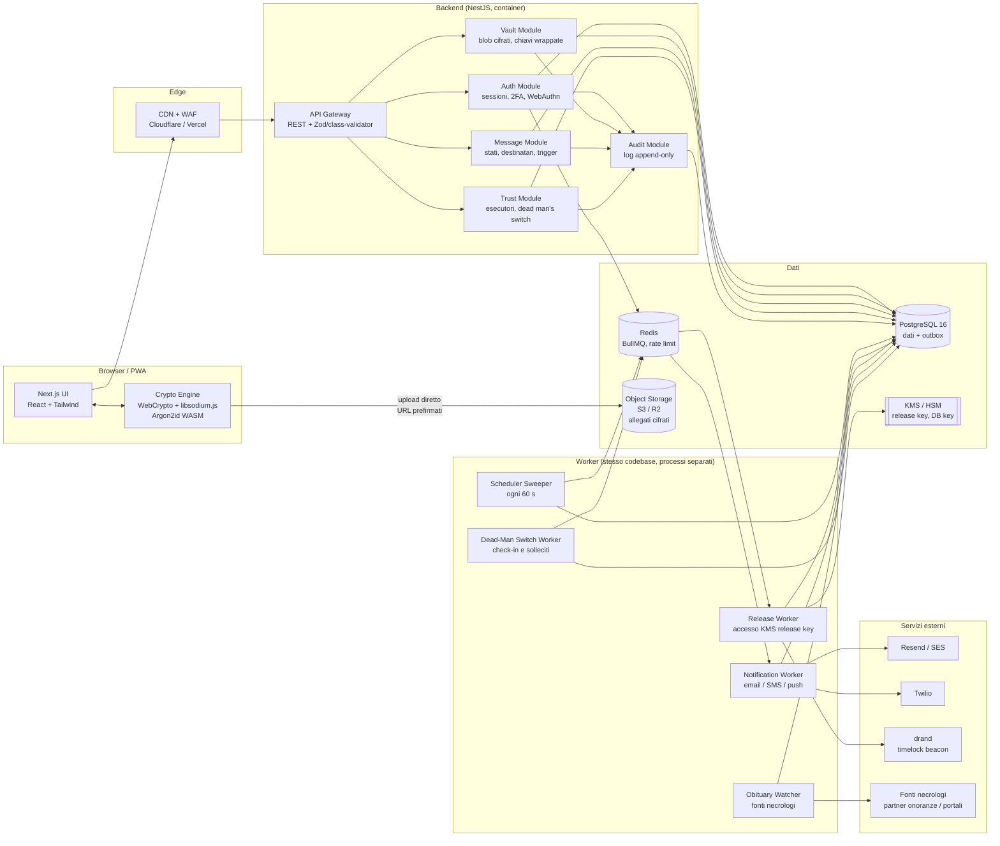
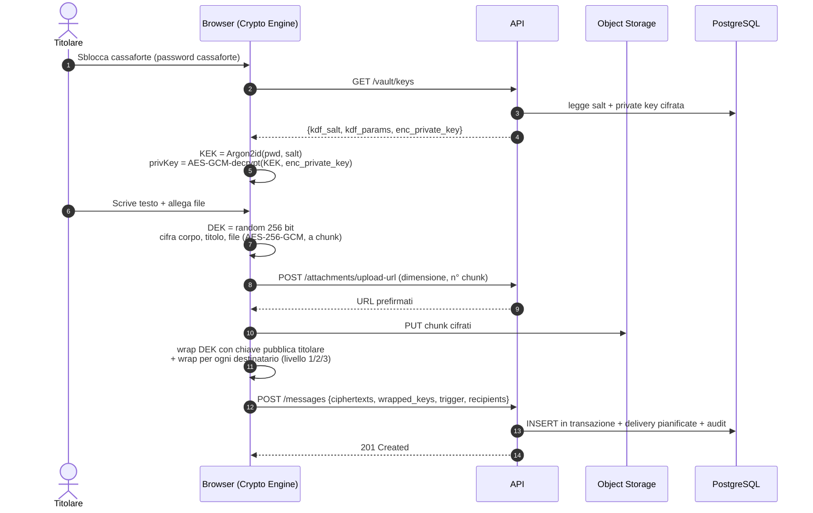
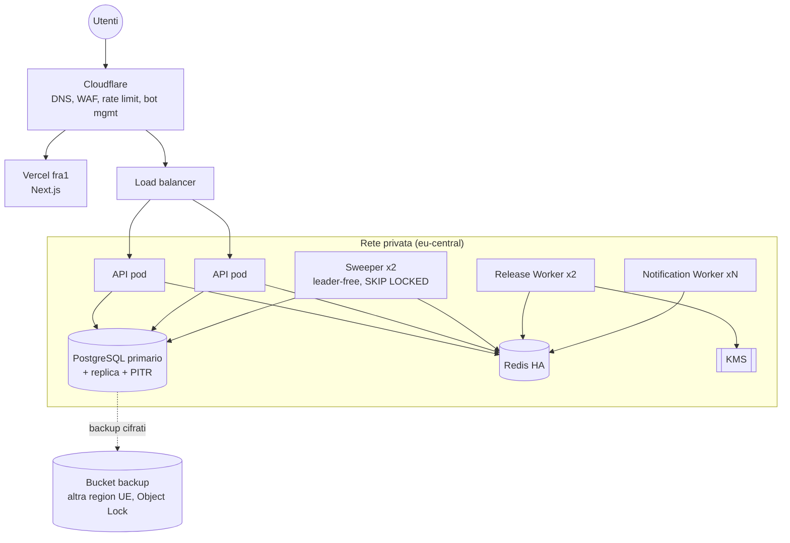

# 02 — Architettura e stack

## 1. Principi architetturali

1. **Zero-knowledge by default.** Tutto ciò che è contenuto (testo, titoli, allegati, rubrica) viene cifrato nel browser. Il backend è un "custode di buste chiuse".
2. **Il database è la fonte di verità del tempo.** Le consegne future vivono in tabelle PostgreSQL, non in code volatili. Redis/BullMQ serve solo per l'esecuzione a breve termine.
3. **Separazione dei poteri.** Il servizio che rilascia i messaggi (Release Worker) è un processo distinto, con credenziali proprie e unico autorizzato a usare la chiave KMS di rilascio.
4. **Fail-safe, non fail-open.** In caso di dubbio (segnali contrastanti, errori di verifica) il sistema **non** consegna e chiede conferma umana.
5. **Monolite modulare prima, microservizi poi.** Un backend NestJS con moduli ben separati, deployabile come API + worker distinti dallo stesso codebase.

## 2. Diagramma logico dei componenti



## 3. Flusso dati principale

### 3.1 Scrittura di un messaggio



### 3.2 Esecuzione di un trigger (vista d'insieme)

```
[PostgreSQL: delivery.due_at <= now() AND status='PENDING']
        │  Sweeper (ogni 60 s, SELECT … FOR UPDATE SKIP LOCKED)
        ▼
[delivery.status = 'QUEUED'] ──► BullMQ "release" (jobId = delivery_id → idempotente)
        │  Release Worker
        ▼
 apre il sigillo del codice (timelock drand / Shamir+KMS) se livello 3
 genera notifica dal template, salva in outbox
        │
        ▼
 BullMQ "notify" ──► Notification Worker ──► Resend / Twilio
        │                                     │
        ▼                                     ▼
 delivery_attempt (esito, provider_id)   webhook provider (delivered/bounced)
        │
        ▼
 delivery.status = 'SENT' → 'OPENED' alla prima lettura
 distruzione del codice in chiaro (memoria) e dello share rilasciato
```

Dettagli temporali in [06-flussi-consegna.md](06-flussi-consegna.md).

## 4. Stack tecnologico

| Livello | Scelta | Motivazione | Alternative valutate |
|---|---|---|---|
| Frontend | **Next.js 15 (App Router) + React 19 + TypeScript** | SSR per pagine pubbliche/SEO, RSC per shell, componenti client per la cassaforte | Remix, SvelteKit |
| Styling | **TailwindCSS 4 + Radix UI / shadcn/ui** | Componenti accessibili (focus, ARIA) pronti; tema scuro/chiaro con CSS variables | Chakra UI |
| Editor | **TipTap (ProseMirror)** | Estensioni controllate (solo marcatori consentiti), output JSON → nessun HTML arbitrario | Lexical, Quill |
| Sanitizzazione | **DOMPurify** al rendering | Il contenuto è decifrato nel client: il server non può sanitizzarlo | — |
| Crittografia client | **WebCrypto** (AES-GCM, HKDF) + **libsodium.js** (X25519, sealed box, secretstream) + **argon2-browser / hash-wasm** (Argon2id) | Primitive standard, auditate; niente crittografia "fatta in casa" | tweetnacl |
| Timelock | **tlock-js (drand quicknet)** | Cifratura verso un round futuro: indecifrabile da chiunque prima della data | — |
| Segreti condivisi | **Shamir's Secret Sharing** (es. `shamir-secret-sharing` di Privy, auditata) | Split del codice tra server ed esecutori | — |
| i18n | **next-intl** (ICU) | Pluralizzazione, date, routing per locale | i18next |
| Backend | **NestJS (Node 22, TypeScript)** | Moduli, DI, guard per autorizzazioni, ecosistema maturo; stesso linguaggio del client per i formati crypto | FastAPI, Django |
| ORM | **Prisma** (o Drizzle) + SQL raw per lo sweeper | Migrazioni versionate; `SKIP LOCKED` in SQL esplicito | TypeORM |
| Database | **PostgreSQL 16** (gestito, es. Neon/RDS/Supabase in UE) | Transazioni, `SKIP LOCKED`, JSONB, RLS come difesa in profondità | — |
| Code | **Redis 7 + BullMQ** | Retry, backoff, rate limit per provider, dashboard | Temporal (valutato per v2: workflow lunghi del trigger decesso) |
| Storage | **Cloudflare R2** o **S3** (eu) con SSE + versioning | Allegati già cifrati lato client; SSE come secondo strato | — |
| KMS | **AWS KMS / GCP Cloud KMS** (HSM-backed) | Chiave di rilascio non esportabile; policy IAM per il solo Release Worker; audit CloudTrail | HashiCorp Vault |
| Auth | **Implementazione propria** su librerie standard (`@node-rs/argon2`, `otplib`, `@simplewebauthn/server`), sessioni in PostgreSQL/Redis | La cassaforte richiede comunque crypto custom; evita di affidare l'identità di un servizio così sensibile a terzi; nessun lock-in per un servizio pensato per decenni | Auth.js, Clerk, Auth0 (accettabili per MVP rapido: solo login, mai la cassaforte) |
| Email | **Resend** (primario) + **Amazon SES** (failover) | API semplice, template React Email; failover per affidabilità | SendGrid, Mailgun |
| SMS | **Twilio** (primario) + **Vonage** (failover) | Copertura, sender ID alfanumerico registrato | MessageBird |
| Push (v2) | Web Push (VAPID) / Expo per app companion | — | — |
| Hosting | **Vercel** (frontend, region `fra1`) + **Railway / Render / AWS ECS** (API e worker, region UE) | Separazione statico/dinamico; worker long-running fuori da serverless | Fly.io |
| Osservabilità | OpenTelemetry → Grafana / Datadog; **Sentry** con scrubbing | Metriche su sweeper lag, tasso di consegna, retry | — |
| CI/CD | GitHub Actions: lint, typecheck, test, SAST (CodeQL, Semgrep), SCA (Dependabot/Renovate), secret scanning, build firmata | — | — |

## 5. Struttura del repository (prevista)

```
secret-vault/
├── apps/
│   ├── web/                 # Next.js (UI, i18n, crypto engine client)
│   └── api/                 # NestJS (API + worker entrypoint)
│       └── src/
│           ├── auth/  vault/  messages/  recipients/
│           ├── trust/       # esecutori, dead man's switch, necrologi
│           ├── delivery/    # sweeper, release, notification
│           ├── audit/  gdpr/  common/
│           └── main.api.ts | main.worker.ts
├── packages/
│   ├── crypto/              # formati busta, versioning, test vector (condiviso web/api/tool offline)
│   ├── shared/              # tipi DTO, schemi Zod, costanti
│   ├── email-templates/     # React Email, IT/EN
│   └── ui/                  # design system
├── tools/
│   └── vault-export-reader/ # CLI open source per decifrare l'export offline
├── docs/
└── infra/                   # Terraform / IaC
```

## 6. Deployment



- **Ambienti**: `dev`, `staging` (dati sintetici, provider in sandbox), `prod`.
- **Segreti**: in Secret Manager, mai in repository; rotazione trimestrale.
- **Backup**: PITR + snapshot giornalieri cifrati con chiave KMS distinta, *Object Lock* (WORM) per resistere a ransomware; test di ripristino mensile automatizzato.
- **Scalabilità**: API e Notification Worker scalano su CPU/coda; lo sweeper scala con istanze multiple grazie a `SKIP LOCKED`; partizionamento mensile di `delivery_attempt` e `audit_log`.
