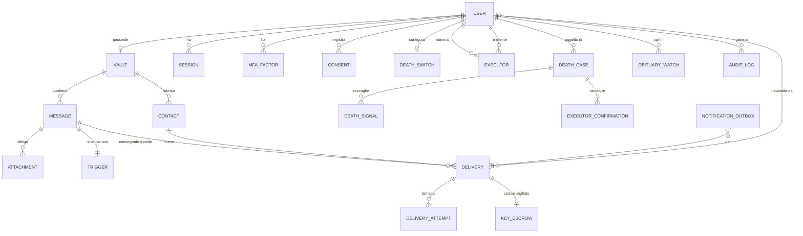

# 03 — Modello dati

## 1. Convenzioni

- Chiavi primarie `uuid` (v7, ordinabili nel tempo).
- Timestamp `timestamptz` in UTC; il fuso del destinatario è salvato a parte.
- Prefisso `enc_` = **cifrato lato client** (il server non può leggerlo). Tipo `bytea`, formato busta versionato (vedi 04).
- Prefisso `sealed_` = cifrato lato server con chiave KMS (dati che il server deve poter usare: recapiti per l'invio).
- Suffisso `_bidx` = *blind index* (HMAC-SHA256 con chiave KMS) per ricerche di uguaglianza su dati cifrati, es. "trova consegne per questa email verificata".
- Soft delete solo dove serve audit; i contenuti vengono eliminati fisicamente (+ crypto-shredding).

## 2. Diagramma ER



## 3. Entità principali

| Entità | Scopo | Dati sensibili e protezione |
|---|---|---|
| `app_user` | Identità e login | email `sealed_` + `_bidx`; password hash Argon2id |
| `vault` | Materiale crittografico della cassaforte | chiave privata `enc_` con KEK (password) e con chiave di recupero |
| `message` | Messaggio | titolo, corpo `enc_` (DEK); DEK wrappata per il titolare |
| `attachment` | File | nome, MIME, contenuto `enc_`; solo dimensione e conteggio chunk in chiaro |
| `contact` | Rubrica del titolare | tutto `enc_` (nome, relazione, recapiti) |
| `trigger` | Condizione di attivazione | tipo e data in chiaro (necessari allo scheduler) |
| `delivery` | Un messaggio verso un destinatario | recapito `sealed_` + `_bidx`; DEK wrappata per il destinatario; token link hash |
| `key_escrow` | Codice di accesso sigillato (livello 3) | ciphertext timelock / share Shamir cifrato KMS |
| `delivery_attempt` | Ogni tentativo di invio | id provider, esito, errore (senza contenuti) |
| `notification_outbox` | Pattern outbox | payload notifica `sealed_`, eliminato dopo l'invio |
| `death_switch` | Dead man's switch | intervallo, scadenze |
| `executor` | Esecutori digitali | share Shamir cifrato con la chiave pubblica dell'esecutore |
| `death_case` | Procedura di verifica decesso | stato macchina a stati, scadenze |
| `death_signal` | Segnali (check-in mancato, necrologio, segnalazione) | fonte, punteggio match |
| `obituary_watch` | Dati per match necrologi (opt-in) | `sealed_` |
| `audit_log` | Log append-only con hash chain | nessun contenuto |
| `consent` | Registro consensi | versione documento, timestamp, IP troncato |

## 4. DDL PostgreSQL

```sql
-- ============ IDENTITÀ ============
CREATE TYPE user_status AS ENUM ('PENDING_VERIFICATION','ACTIVE','LOCKED','DECEASED','DELETION_REQUESTED');

CREATE TABLE app_user (
  id                 uuid PRIMARY KEY,
  display_name       text        NOT NULL,             -- mostrato ai destinatari
  sealed_email       bytea       NOT NULL,
  email_bidx         bytea       NOT NULL UNIQUE,
  email_verified_at  timestamptz,
  sealed_phone       bytea,
  phone_bidx         bytea UNIQUE,
  phone_verified_at  timestamptz,
  password_hash      text        NOT NULL,             -- argon2id$v=19$m=65536,t=3,p=1$...
  locale             text        NOT NULL DEFAULT 'it',
  timezone           text        NOT NULL DEFAULT 'Europe/Rome',
  status             user_status NOT NULL DEFAULT 'PENDING_VERIFICATION',
  public_key         bytea,                            -- X25519, per consegna diretta (livello 1)
  created_at         timestamptz NOT NULL DEFAULT now(),
  updated_at         timestamptz NOT NULL DEFAULT now()
);

CREATE TABLE session (
  id_hash        bytea PRIMARY KEY,                    -- SHA-256 del token in cookie
  user_id        uuid NOT NULL REFERENCES app_user(id) ON DELETE CASCADE,
  mfa_passed     boolean NOT NULL DEFAULT false,
  user_agent     text,
  ip_prefix      inet,                                 -- /24 IPv4, /48 IPv6
  created_at     timestamptz NOT NULL DEFAULT now(),
  last_seen_at   timestamptz NOT NULL DEFAULT now(),
  expires_at     timestamptz NOT NULL,
  revoked_at     timestamptz
);
CREATE INDEX ON session (user_id) WHERE revoked_at IS NULL;

CREATE TYPE mfa_kind AS ENUM ('TOTP','WEBAUTHN','BACKUP_CODE');
CREATE TABLE mfa_factor (
  id            uuid PRIMARY KEY,
  user_id       uuid NOT NULL REFERENCES app_user(id) ON DELETE CASCADE,
  kind          mfa_kind NOT NULL,
  sealed_secret bytea,                                 -- TOTP secret / hash backup code
  credential_id bytea,                                 -- WebAuthn
  public_key    bytea,
  sign_count    bigint,
  label         text,
  created_at    timestamptz NOT NULL DEFAULT now(),
  last_used_at  timestamptz
);

CREATE TABLE auth_token (                              -- verifica email, reset password, OTP telefono
  token_hash  bytea PRIMARY KEY,
  user_id     uuid NOT NULL REFERENCES app_user(id) ON DELETE CASCADE,
  purpose     text NOT NULL CHECK (purpose IN ('VERIFY_EMAIL','RESET_PASSWORD','VERIFY_PHONE','CHECKIN','CANCEL_DEATH_CASE')),
  expires_at  timestamptz NOT NULL,
  used_at     timestamptz
);

-- ============ CASSAFORTE ============
CREATE TABLE vault (
  user_id                 uuid PRIMARY KEY REFERENCES app_user(id) ON DELETE CASCADE,
  crypto_version          smallint NOT NULL DEFAULT 1,
  kdf_salt                bytea NOT NULL,              -- 16 byte
  kdf_params              jsonb NOT NULL,              -- {"alg":"argon2id","m":65536,"t":3,"p":1}
  public_key              bytea NOT NULL,              -- X25519 della cassaforte
  enc_private_key_pwd     bytea NOT NULL,              -- privKey cifrata con KEK(password)
  enc_private_key_recovery bytea NOT NULL,             -- privKey cifrata con KEK(chiave di recupero)
  verifier                bytea NOT NULL,              -- HMAC(KEK, "vault-verifier"): verifica lato client, utile per rate limit
  failed_unlocks          int NOT NULL DEFAULT 0,
  locked_until            timestamptz,
  created_at              timestamptz NOT NULL DEFAULT now(),
  updated_at              timestamptz NOT NULL DEFAULT now()
);

CREATE TABLE contact (
  id           uuid PRIMARY KEY,
  vault_id     uuid NOT NULL REFERENCES vault(user_id) ON DELETE CASCADE,
  enc_payload  bytea NOT NULL,                         -- {name, relation, email, phone, notes} cifrati
  linked_user_id uuid REFERENCES app_user(id),         -- se il contatto è un utente (consegna diretta)
  created_at   timestamptz NOT NULL DEFAULT now(),
  updated_at   timestamptz NOT NULL DEFAULT now()
);

-- ============ MESSAGGI ============
CREATE TYPE message_status AS ENUM
  ('DRAFT','SCHEDULED','ARMED','RELEASING','DELIVERED','PARTIALLY_DELIVERED','CANCELLED','FAILED');

CREATE TABLE message (
  id                 uuid PRIMARY KEY,
  vault_id           uuid NOT NULL REFERENCES vault(user_id) ON DELETE CASCADE,
  status             message_status NOT NULL DEFAULT 'DRAFT',
  crypto_version     smallint NOT NULL DEFAULT 1,
  enc_title          bytea NOT NULL,
  enc_body           bytea NOT NULL,                   -- JSON TipTap cifrato
  owner_wrapped_dek  bytea NOT NULL,                   -- DEK sealed-box verso public_key del vault
  reference_date     date,                             -- "scritto per…" (in chiaro solo se l'utente lo consente; altrimenti dentro enc_body)
  version            int NOT NULL DEFAULT 1,           -- usato come AAD e per optimistic locking
  created_at         timestamptz NOT NULL DEFAULT now(),
  updated_at         timestamptz NOT NULL DEFAULT now()
);
CREATE INDEX ON message (vault_id, status);

CREATE TABLE attachment (
  id            uuid PRIMARY KEY,
  message_id    uuid NOT NULL REFERENCES message(id) ON DELETE CASCADE,
  storage_key   text NOT NULL,                         -- chiave opaca nell'object storage
  enc_meta      bytea NOT NULL,                        -- {filename, mime, sha256_plain}
  size_bytes    bigint NOT NULL,                       -- dimensione ciphertext (quota)
  chunk_count   int NOT NULL,
  chunk_size    int NOT NULL DEFAULT 1048576,
  upload_state  text NOT NULL DEFAULT 'PENDING' CHECK (upload_state IN ('PENDING','COMPLETE')),
  created_at    timestamptz NOT NULL DEFAULT now()
);

CREATE TYPE trigger_kind AS ENUM ('FIXED_DATE','MANUAL','DEATH','DATE_OR_DEATH');
CREATE TABLE trigger (
  message_id      uuid PRIMARY KEY REFERENCES message(id) ON DELETE CASCADE,
  kind            trigger_kind NOT NULL,
  fire_at         timestamptz,                         -- FIXED_DATE / DATE_OR_DEATH
  fire_timezone   text,
  occasion        text,                                -- 'BIRTHDAY','ANNIVERSARY','WEDDING','COMING_OF_AGE','OTHER'
  fired_at        timestamptz,
  CHECK ((kind IN ('FIXED_DATE','DATE_OR_DEATH')) = (fire_at IS NOT NULL))
);
CREATE INDEX trigger_due_idx ON trigger (fire_at) WHERE fired_at IS NULL AND fire_at IS NOT NULL;

-- ============ CONSEGNE ============
CREATE TYPE delivery_status AS ENUM
  ('PENDING','QUEUED','RELEASED','SENT','BOUNCED','FAILED','OPENED','CANCELLED');
CREATE TYPE key_mode AS ENUM ('DIRECT_PUBKEY','SENDER_SHARES_CODE','ESCROW_TIMELOCK','ESCROW_SHAMIR');
CREATE TYPE channel AS ENUM ('EMAIL','SMS','EMAIL_AND_SMS');

CREATE TABLE delivery (
  id                     uuid PRIMARY KEY,
  message_id             uuid NOT NULL REFERENCES message(id) ON DELETE CASCADE,
  contact_id             uuid REFERENCES contact(id) ON DELETE SET NULL,
  channel                channel NOT NULL,
  sealed_email           bytea,
  email_bidx             bytea,
  sealed_phone           bytea,
  phone_bidx             bytea,
  sealed_recipient_name  bytea NOT NULL,              -- per "Ciao [Nome]"
  recipient_locale       text NOT NULL DEFAULT 'it',
  recipient_timezone     text NOT NULL DEFAULT 'Europe/Rome',
  key_mode               key_mode NOT NULL,
  wrapped_dek            bytea NOT NULL,              -- DEK cifrata con chiave del destinatario (pubkey o KDF(codice))
  code_kdf_salt          bytea,                       -- per modalità basate su codice
  link_token_hash        bytea UNIQUE,                -- SHA-256 del token nel link
  status                 delivery_status NOT NULL DEFAULT 'PENDING',
  due_at                 timestamptz,                 -- calcolato dal trigger (o al rilascio per DEATH)
  not_before_local_hour  smallint DEFAULT 8,          -- quiet hours
  redeemed_by            uuid REFERENCES app_user(id),
  released_at            timestamptz,
  first_opened_at        timestamptz,
  failed_code_attempts   int NOT NULL DEFAULT 0,
  attempt_count          int NOT NULL DEFAULT 0,
  next_attempt_at        timestamptz,
  created_at             timestamptz NOT NULL DEFAULT now(),
  updated_at             timestamptz NOT NULL DEFAULT now()
);
CREATE INDEX delivery_due_idx      ON delivery (due_at)          WHERE status = 'PENDING';
CREATE INDEX delivery_retry_idx    ON delivery (next_attempt_at) WHERE status IN ('QUEUED','RELEASED','BOUNCED');
CREATE INDEX delivery_email_lookup ON delivery (email_bidx)      WHERE status IN ('SENT','OPENED','RELEASED');
CREATE INDEX delivery_phone_lookup ON delivery (phone_bidx)      WHERE status IN ('SENT','OPENED','RELEASED');

CREATE TABLE key_escrow (
  delivery_id         uuid PRIMARY KEY REFERENCES delivery(id) ON DELETE CASCADE,
  mode                key_mode NOT NULL CHECK (mode IN ('ESCROW_TIMELOCK','ESCROW_SHAMIR')),
  tlock_round         bigint,                          -- round drand corrispondente a due_at
  tlock_ciphertext    bytea,                           -- codice cifrato verso il round (+ involucro KMS)
  shamir_threshold    smallint,
  server_share_kms    bytea,                           -- share del server cifrato con KMS release key
  destroyed_at        timestamptz                      -- valorizzato dopo l'invio
);

CREATE TABLE delivery_attempt (
  id             bigserial,
  delivery_id    uuid NOT NULL REFERENCES delivery(id) ON DELETE CASCADE,
  channel        text NOT NULL,                        -- 'EMAIL'|'SMS'
  provider       text NOT NULL,                        -- 'resend','ses','twilio','vonage'
  provider_msg_id text,
  status         text NOT NULL,                        -- 'ACCEPTED','DELIVERED','BOUNCED','FAILED','COMPLAINED'
  error_code     text,
  attempted_at   timestamptz NOT NULL DEFAULT now(),
  PRIMARY KEY (id, attempted_at)
) PARTITION BY RANGE (attempted_at);

CREATE TABLE notification_outbox (
  id             uuid PRIMARY KEY,
  delivery_id    uuid NOT NULL REFERENCES delivery(id) ON DELETE CASCADE,
  channel        text NOT NULL,
  idempotency_key text NOT NULL UNIQUE,                -- delivery_id:channel:attempt
  sealed_payload bytea NOT NULL,                       -- testo già renderizzato (contiene il codice): cancellato dopo ACCEPTED
  created_at     timestamptz NOT NULL DEFAULT now(),
  processed_at   timestamptz
);

-- ============ TESTAMENTO DIGITALE ============
CREATE TABLE death_switch (
  user_id              uuid PRIMARY KEY REFERENCES app_user(id) ON DELETE CASCADE,
  enabled              boolean NOT NULL DEFAULT false,
  checkin_interval     interval NOT NULL DEFAULT '90 days',
  grace_period         interval NOT NULL DEFAULT '30 days',
  reminders_sent       smallint NOT NULL DEFAULT 0,
  last_checkin_at      timestamptz NOT NULL DEFAULT now(),
  next_due_at          timestamptz NOT NULL,
  allow_unattended_release boolean NOT NULL DEFAULT false,  -- RF-56: sblocco senza esecutori
  contest_period       interval NOT NULL DEFAULT '72 hours' CHECK (contest_period >= interval '24 hours')
);
CREATE INDEX ON death_switch (next_due_at) WHERE enabled;

CREATE TYPE executor_status AS ENUM ('INVITED','ACCEPTED','DECLINED','REVOKED');
CREATE TABLE executor (
  id                  uuid PRIMARY KEY,
  owner_id            uuid NOT NULL REFERENCES app_user(id) ON DELETE CASCADE,
  executor_user_id    uuid REFERENCES app_user(id),
  sealed_invite_email bytea NOT NULL,
  status              executor_status NOT NULL DEFAULT 'INVITED',
  enc_shamir_shares   bytea,                           -- share (per tutti i messaggi ESCROW_SHAMIR) sealed-box verso la pubkey dell'esecutore
  created_at          timestamptz NOT NULL DEFAULT now(),
  accepted_at         timestamptz
);

CREATE TABLE death_policy (
  owner_id     uuid PRIMARY KEY REFERENCES app_user(id) ON DELETE CASCADE,
  quorum       smallint NOT NULL DEFAULT 2 CHECK (quorum >= 1)
);

CREATE TYPE death_case_status AS ENUM
  ('OPEN','AWAITING_EXECUTORS','CONTEST_PERIOD','CONFIRMED','RELEASED','CANCELLED_BY_OWNER','REJECTED');
CREATE TABLE death_case (
  id             uuid PRIMARY KEY,
  owner_id       uuid NOT NULL REFERENCES app_user(id) ON DELETE CASCADE,
  status         death_case_status NOT NULL DEFAULT 'OPEN',
  opened_reason  text NOT NULL,                        -- 'CHECKIN_MISSED','OBITUARY_MATCH','EXECUTOR_REPORT'
  contest_until  timestamptz,
  opened_at      timestamptz NOT NULL DEFAULT now(),
  closed_at      timestamptz
);
CREATE UNIQUE INDEX one_open_case_per_owner ON death_case (owner_id)
  WHERE status IN ('OPEN','AWAITING_EXECUTORS','CONTEST_PERIOD','CONFIRMED');

CREATE TABLE death_signal (
  id           uuid PRIMARY KEY,
  case_id      uuid NOT NULL REFERENCES death_case(id) ON DELETE CASCADE,
  source       text NOT NULL,                          -- 'DMS','OBITUARY:<provider>','EXECUTOR:<id>'
  confidence   numeric(4,3) NOT NULL,                  -- 0..1
  evidence_ref text,                                   -- URL necrologio / id documento (cancellato a fine caso)
  created_at   timestamptz NOT NULL DEFAULT now()
);

CREATE TABLE executor_confirmation (
  case_id       uuid NOT NULL REFERENCES death_case(id) ON DELETE CASCADE,
  executor_id   uuid NOT NULL REFERENCES executor(id),
  decision      text NOT NULL CHECK (decision IN ('CONFIRM','DENY')),
  share_upload  bytea,                                 -- share Shamir ri-cifrato verso la release key (pubblica) del server
  decided_at    timestamptz NOT NULL DEFAULT now(),
  PRIMARY KEY (case_id, executor_id)
);

CREATE TABLE obituary_watch (
  user_id          uuid PRIMARY KEY REFERENCES app_user(id) ON DELETE CASCADE,
  sealed_identity  bytea NOT NULL,                     -- nome, cognome, nascita, comune
  match_key_bidx   bytea NOT NULL,                     -- HMAC(normalize(cognome+nome+anno nascita))
  consent_id       uuid NOT NULL,
  enabled          boolean NOT NULL DEFAULT true
);
CREATE INDEX ON obituary_watch (match_key_bidx) WHERE enabled;

-- ============ AUDIT & CONSENSI ============
CREATE TABLE audit_log (
  id          bigserial,
  user_id     uuid,                                    -- non FK: sopravvive alla cancellazione in forma pseudonimizzata
  actor       text NOT NULL,                           -- 'USER','RECIPIENT','EXECUTOR','SYSTEM','STAFF:<id>'
  action      text NOT NULL,                           -- 'LOGIN','VAULT_UNLOCK','VAULT_UNLOCK_FAILED','MESSAGE_CREATE','DELIVERY_SENT',...
  target_type text,
  target_id   uuid,
  ip_prefix   inet,
  meta        jsonb,                                   -- MAI contenuti o recapiti
  prev_hash   bytea,
  hash        bytea NOT NULL,                          -- SHA-256(prev_hash || riga): tamper-evident
  created_at  timestamptz NOT NULL DEFAULT now(),
  PRIMARY KEY (id, created_at)
) PARTITION BY RANGE (created_at);

CREATE TABLE consent (
  id           uuid PRIMARY KEY,
  user_id      uuid NOT NULL REFERENCES app_user(id) ON DELETE CASCADE,
  purpose      text NOT NULL,                          -- 'TOS','PRIVACY','OBITUARY_MONITORING','MARKETING'
  doc_version  text NOT NULL,
  granted      boolean NOT NULL,
  created_at   timestamptz NOT NULL DEFAULT now()
);
```

## 5. Macchine a stati

### Messaggio
```
DRAFT ──(programma)──► SCHEDULED (data/manuale)  ──┐
  │                                                  ├─(trigger)─► RELEASING ─► DELIVERED
  └──(arma decesso)──► ARMED (decesso / data∨decesso)┘                   │
         ▲  │                                                            └─► PARTIALLY_DELIVERED / FAILED
         └──┴──(annulla)──► CANCELLED
```

### Consegna
```
PENDING ─► QUEUED ─► RELEASED ─► SENT ─► OPENED
                         │         │
                         │         └─► BOUNCED ─(retry/cambio canale)─► SENT
                         └─► FAILED (dopo max tentativi → escalation esecutori/titolare)
```

### Caso decesso
```
OPEN ─► AWAITING_EXECUTORS ─(quorum CONFIRM)─► CONTEST_PERIOD ─(scade)─► CONFIRMED ─► RELEASED
  │              │                                   │
  │              └─(DENY a maggioranza)─► REJECTED    └─(titolare annulla)─► CANCELLED_BY_OWNER
  └─(titolare fa check-in)─► CANCELLED_BY_OWNER
```

## 6. Retention

| Dato | Conservazione |
|---|---|
| Messaggi e allegati non consegnati | Fino a consegna/cancellazione da parte del titolare |
| Messaggi consegnati | Configurabile dal titolare: 1, 5 anni o "per sempre" (default 5); il destinatario può salvarne copia |
| `notification_outbox.sealed_payload` | Cancellato appena il provider accetta il messaggio |
| `key_escrow` (materiale) | Distrutto al rilascio (`destroyed_at`) |
| `delivery_attempt` | 24 mesi |
| `audit_log` | 24 mesi (sicurezza), poi pseudonimizzato e aggregato |
| Evidenze decesso (`evidence_ref`, certificati) | Cancellate a chiusura caso + 30 gg |
| Sessioni scadute, token | 30 gg |
| Account cancellato | Crypto-shredding immediato; righe eliminate entro 30 gg; backup entro 35 gg |
