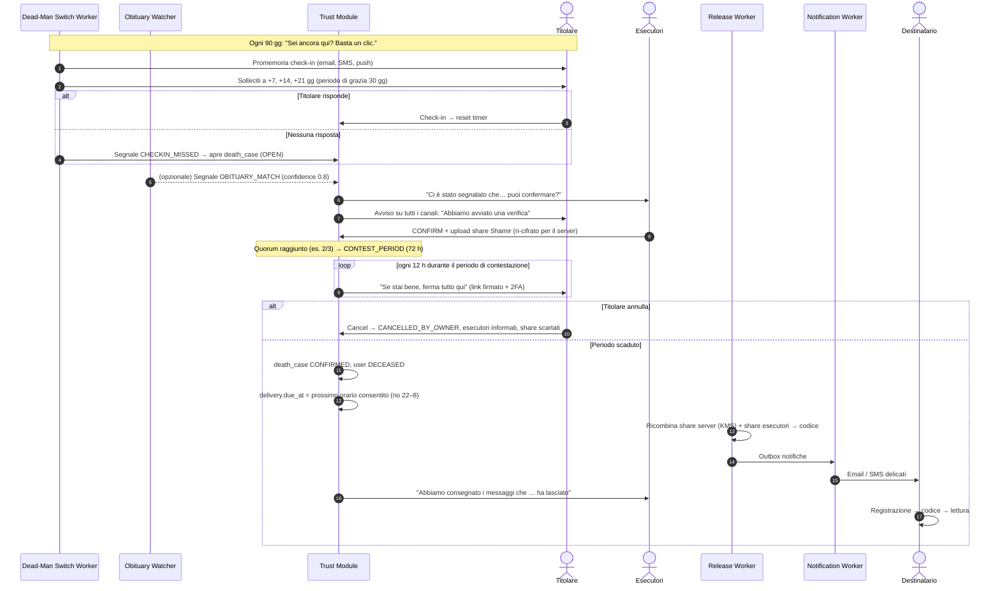

# 06 — Flussi di consegna step-by-step

## 1. Consegna a data fissa (livello 3, timelock)

**Esempio**: Giulia scrive il 3 maggio 2026 a Tommaso per i suoi 18 anni, il 14 marzo 2034 ore 9:00 (Europe/Rome).

| Quando | Chi | Cosa succede |
|---|---|---|
| T0 = 3/5/2026 | Browser di Giulia | Genera DEK e cifra messaggio/allegati. Genera codice C (100 bit). `wrapped_dek = AES-GCM(Argon2id(C, salt), DEK)`. Calcola il round drand per il 14/3/2034 09:00 CET e cifra C con tlock → `tlock_ciphertext`. Invia tutto all'API. C viene cancellato dalla memoria. |
| T0 | API | Transazione: `message(SCHEDULED)`, `trigger(FIXED_DATE, fire_at=2034-03-14T08:00Z)`, `delivery(PENDING, due_at=…)`, `key_escrow` (tlock avvolto in KMS), audit `MESSAGE_SCHEDULED`. |
| 2026 → 2034 | — | Il messaggio è dormiente. Nessuno può aprire C: drand non ha ancora pubblicato il round. Giulia può modificare/annullare. Ogni anno: email "I tuoi messaggi programmati sono al sicuro" (verifica che i recapiti di Giulia siano attivi). |
| T −7 gg (7/3/2034) | Sweeper → Notification | Promemoria a Giulia: "Tra una settimana Tommaso riceverà 'Per i tuoi 18 anni'. Vuoi cambiare qualcosa?" |
| T (14/3/2034 08:00Z) | drand | Pubblica la firma del round. |
| T + ≤60 s | Sweeper | `SELECT … WHERE status='PENDING' AND due_at<=now() FOR UPDATE SKIP LOCKED` → `QUEUED`, job `release:{delivery_id}`. |
| T + secondi | Release Worker | KMS-decrypt involucro → tlock-decrypt con la firma del round → C. Rende i template (email con link; SMS con C), li salva in `notification_outbox` cifrati, `delivery=RELEASED`, `key_escrow.destroyed_at=now()`, azzera C in memoria. Accoda `notify`. |
| T + secondi | Notification Worker | Invia email (Resend) e SMS (Twilio) con idempotency key. Esito → `delivery_attempt`; outbox payload cancellato all'accettazione. `delivery=SENT`. |
| T + minuti | Webhook provider | `delivered` / `bounced`. Se bounce email → retry con SES; se fallisce tutto → solo SMS con link + codice; se fallisce anche SMS → notifica a Giulia (se viva) o esecutori. |
| T + ore/giorni | Tommaso | Apre il link → si registra con l'email destinataria (verifica) → la consegna viene associata (`redeemed_by`) → inserisce C → il browser deriva la chiave, apre la DEK, decifra. Se crea una cassaforte, la DEK viene ri-sigillata per la sua chiave pubblica e `wrapped_dek` basata su C viene eliminata. `delivery=OPENED`. |
| T + 30 gg senza apertura | Sweeper | Promemoria gentile al destinatario (max 2: a 30 e 90 gg). |

**Retry policy** (Notification Worker, per canale): tentativi a +1 min, +5 min, +30 min, +2 h, +12 h, +24 h (backoff esponenziale con jitter), failover di provider dal 2° tentativo, cambio canale dal 4°. Errori permanenti (email inesistente, numero non valido) → escalation immediata.

## 2. Consegna manuale

- **"Invia ora"**: `trigger(MANUAL)`, `delivery.due_at = now()`; lo sweeper la prende al giro successivo (≤ 60 s). In livello 3 non c'è timelock (data = adesso): il codice viene consegnato dal browser del titolare già sigillato con la sola chiave pubblica di rilascio (RSA-OAEP/X25519 via KMS).
- **"Quando deciderò"**: messaggio `SCHEDULED` senza `due_at`; il titolare preme "Invia" in futuro (richiede cassaforte aperta).

## 3. Consegna al decesso

**Sequenza temporale tipica**

| Giorno | Evento |
|---|---|
| 0 | Scadenza check-in (90 gg dall'ultimo) |
| 0, 7, 14, 21 | Solleciti al titolare, canali crescenti |
| 30 | Fine periodo di grazia → `death_case OPEN` → richiesta agli esecutori + avviso al titolare |
| 30–44 | Gli esecutori confermano (promemoria a +3 e +7 gg; se il quorum non è raggiunto in 14 gg → operatore contatta esecutori; mai sblocco automatico se ci sono esecutori configurati) |
| es. 33 | Quorum raggiunto → periodo di contestazione 72 h |
| 36 | Nessuna contestazione → `CONFIRMED` → rilascio alla prima finestra 8:00–22:00 del destinatario |
| 36 + | Consegna come §1 |

**Casi limite**

| Caso | Comportamento |
|---|---|
| Necrologio di un omonimo | Il match apre solo un caso; senza conferma esecutori nulla si sblocca. Il titolare riceve "Abbiamo trovato un necrologio che potrebbe riguardarti: se non sei tu, ignora o conferma di stare bene." |
| Esecutori in disaccordo | `DENY` dalla maggioranza → `REJECTED`, operatore informato; il timer del check-in riparte. |
| Esecutore deceduto/irraggiungibile | Il titolare viene invitato periodicamente a verificare gli esecutori; se il quorum diventa irraggiungibile → avviso al titolare e alternativa. |
| Titolare in ospedale/coma | Periodo di grazia + contestazione + quorum umano riducono il rischio; gli esecutori sono istruiti a confermare solo il decesso. Possibilità di "pausa viaggio/ricovero" che sospende il check-in fino a 12 mesi. |
| Nessun esecutore e fallback attivo | Dopo 30 gg di grazia + 14 gg di contestazione con contatti ripetuti, sblocco automatico (rischio accettato esplicitamente). |
| Messaggio `DATE_OR_DEATH` | Vince il primo evento; l'altro viene ignorato. |

## 4. Integrazione necrologi (segnale ausiliario, V2)

Realtà del mercato italiano: **non esiste un'API pubblica e affidabile dei decessi** per i privati (ANPR è riservata alle PA). Le fonti possibili:

1. **Partnership con onoranze funebri / aggregatori di necrologi online** (feed strutturato o webhook, con accordo contrattuale e base giuridica).
2. **Portali di necrologi** consultabili pubblicamente — solo se i termini d'uso lo consentono (preferire accordi a scraping).
3. **Segnalazione da esecutori** con eventuale certificato (V2).

Algoritmo di matching (in `OBIT` worker): normalizzazione (minuscole, rimozione accenti/apostrofi, gestione "De/Di/D'"), blocco per cognome+anno nascita via blind index, poi punteggio: nome+cognome (0,4) + data di nascita (0,3) o età coerente (0,15) + comune di residenza/nascita (0,2) + foto/parenti citati (non usati). Soglia 0,7 → `death_signal`. **Mai** sblocco diretto.

## 5. Flusso del destinatario (fallback senza link)

1. Il destinatario ha perso l'email, oppure ha saputo da altri che "Giulia ha lasciato qualcosa".
2. Visita la home → "Ci sono messaggi per me?".
3. Si registra e verifica email e/o telefono.
4. Il sistema cerca consegne `RELEASED/SENT` con `email_bidx`/`phone_bidx` corrispondenti → elenco "Messaggi per te: da Giulia Rossi (1)".
5. Se non ha più il codice:
   - **L3**: al rilascio il codice non viene distrutto subito ma conservato per **90 giorni** in una busta di riserva cifrata con KMS, solo per consentire "Invia di nuovo il codice" al recapito verificato (stesso canale separato). Alla prima apertura o allo scadere dei 90 gg viene distrutto. È un compromesso esplicito (finestra post-trigger) a favore dell'affidabilità; il titolare può disattivarlo.
   - **L2**: il codice ce l'ha solo chi lo ha ricevuto dal titolare; il sistema mostra le istruzioni lasciate dal titolare (es. "chiedi al notaio Bianchi").
   - **L1**: nessun codice necessario.
6. In alternativa: "Cerca per nome di chi ti ha scritto" + codice.
